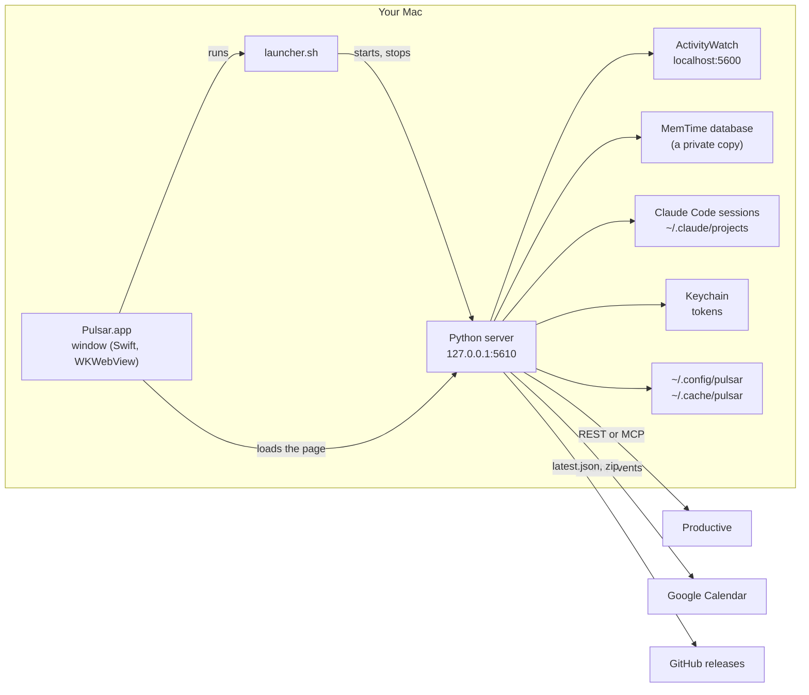
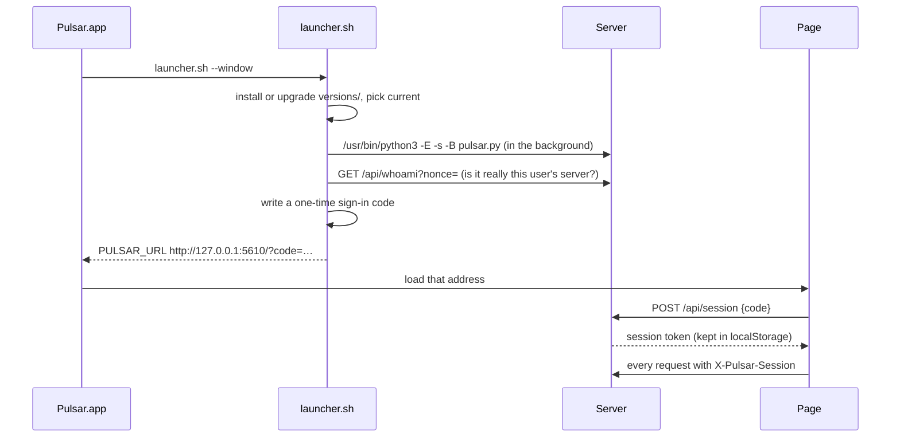
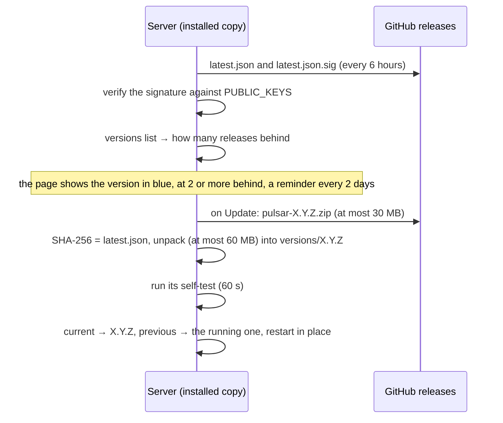

# How Pulsar works

This is the inside view: what runs where, where each number on the page comes from, what is kept and where, and how
a release reaches everyone. For installing and using Pulsar, see the [README](../README.md). For building and
releasing, see [macos/README.md](../macos/README.md).

Pulsar is a small local web app. A Python 3.9 server (standard library only) reads your activity tracker, your
Claude Code sessions, Productive and, if you connect it, Google Calendar. It serves one page, which draws the day and
the report. On a Mac a thin app shows that page in a window of its own. Nothing runs anywhere but on your computer,
except what the Claude Code switch sends to Anthropic when it is on (5.5, 5.7). Nothing is written to Productive
without a click and a confirmation: logging, changing or deleting an entry, Log the day and its Undo, or `pulsar_log`
from a Claude Code session after Claude Code asked you.

## 1. The pieces



| Piece | File | What it does |
|---|---|---|
| Window | `macos/PulsarWindow.swift` | The app's executable. Runs the launcher, loads the page, handles downloads, print, About and the native warp. |
| Launcher | `macos/launcher.sh` | Installs or upgrades the code under `~/Library/Application Support/Pulsar/`, starts the server, rolls back if it does not start, stops it when the window closes. |
| Server | `pulsar.py`, `pulsar/server.py` | The page, its files and a JSON API, on 127.0.0.1 only. |
| Page | `web/` | Plain HTML, CSS and JavaScript, no build step. |
| Release tools | `macos/build_app.sh`, `macos/release.sh` | Build Pulsar.app, build and sign a release. |

## 2. Starting up



1. **The installed copy.** The app carries one version of the code. The launcher keeps full copies in
   `versions/<X.Y.Z>/` with two symlinks, `current` and `previous`, switched atomically. When the app's own version
   is newer than `current` (a new Pulsar.zip was installed), it is copied in and becomes `current`. When `current` is
   newer (Pulsar updated itself since the app was built), `current` stays.
2. **Python.** Always `/usr/bin/python3` (Apple's Command Line Tools; the app offers to install them), with
   `-E -s -B`: no `PYTHON*` variables, no user site-packages, no `.pyc` files. Never `-I`: versions up to 1.0.3 need
   the script's folder on `sys.path`. `pulsar.py` puts its own folder there itself.
3. **Rollback.** If the new `current` does not answer, the launcher writes it into `bad-versions` (never used again)
   and starts `previous`.
4. **Is it ours?** Before it opens anything, the launcher asks `/api/whoami?nonce=` and checks the HMAC of the nonce
   made with this user's key (`~/.config/pulsar/secret`). A server another account or a container started on the same
   port fails this check.
5. **Signing the window in.** The launcher writes a one-time code to `~/.config/pulsar/signin-code` and prints the
   address with it. The page trades the code for a session token (`POST /api/session`). The code works once and only
   for two minutes, and a wrong guess does not spoil it.
6. **Stopping.** Closing the window quits the app, and the app runs `launcher.sh --stop`, which stops only a server
   the app itself started. A server started from a git checkout keeps running.
7. **Self-test.** `pulsar.py --self-test` imports every module, reads from `index.html` every script and style the
   page loads and checks each is there, starts a server on a free port, fetches the page and each of those files,
   and asks it for its version. The updater runs it on every new version before trusting it.

Start-up also tidies old data (`pulsar.py: tidy()`): owner-only permissions on files older versions wrote, copies of
days older than 120 days removed, error logs older than 31 days removed, MemTime copies a killed Pulsar left removed.

## 3. Security

Pulsar holds two powerful things: your Productive access and your Google Calendar access. The rules below keep them
yours.

- **Local only.** The server binds 127.0.0.1. Every request must say `Host: 127.0.0.1` or `localhost`, so a page that
  rebinds its own name to 127.0.0.1 is refused.
- **No other website.** A request another site's page makes is refused: the browser marks it in `Sec-Fetch-Site`; a
  WebSocket handshake, which has no `Sec-Fetch` headers, is caught by `Origin` and `Upgrade`. A link from elsewhere
  may open the page (a navigation to `/`), and nothing more.
- **Signed in.** Everything with data needs a session token in the `X-Pulsar-Session` header. The page keeps it in
  localStorage, which no other site or port can read. The server keeps only its SHA-256, in
  `~/.config/pulsar/sessions.json`, valid 90 days from last use. The launcher and Pulsar in Claude Code (5.6) prove
  themselves with `X-Pulsar-Key` (the key itself). Public without a session: `/`, `/index.html`, `/static/…`,
  `/api/version` and `/api/whoami`.
- **What the key alone opens** (`server.key_refusal`). The key is a file any program of the person's can read, a
  Claude Code session too (in bypass mode it needs no prompt to `cat` it). So on its own it opens only what its two
  holders need: every GET (reading), `POST /api/quit` (the launcher), and `POST /api/log` as `pulsar_log` sends it:
  inside a Log the day run (`run` and `row`, so the entry is journalled, never sent twice, listed with Undo) and never
  with `force`, so the overlap check always holds. Everything else is refused with 403 and needs the page's session:
  changing or deleting an entry, settings (the token, `preview_writes`, the Claude Code switch), updates, Ask Claude,
  the session note, Google Calendar, Productive's test.
- **What a program of the person's can still do.** This is not a wall between the person's own programs and Pulsar,
  and nothing on one account can be. Such a program can log new entries with the key as above (a Claude Code session
  in bypass mode or with a prompt injection can therefore log time without the `pulsar_log` prompt); it can write a
  sign-in code into `~/.config/pulsar/signin-code` and trade it for a session (`POST /api/session`), or read the
  window's token from its WebKit storage, and then do anything the page does; and it can read the keychain items,
  which `/usr/bin/security` created and so trusts. A confirmation click in Pulsar's window for writes made with the
  key was considered and left out: a program that can do all this can also click it through the API, and every
  write from Claude Code would ask twice. What the narrower key does stop is the one-line `curl` that deletes or
  changes entries, or switches Preview's writing on.
- **Writes.** Every POST must carry `X-Pulsar: 1`. A page on another site cannot send a custom header without the
  browser asking this server first (CORS preflight), and this server never says yes.
- **The page itself** is served with a strict Content Security Policy: scripts only from Pulsar
  (`script-src 'self'`), no inline scripts, nothing loaded from the internet.
- **Secrets** go to the macOS login keychain, service `pulsar`: account `productive` (your API token) and account
  `google-calendar` (the Google refresh token). Elsewhere they go in files only their owner can read. They never go
  in `settings.json`, never reach the page, and are cut out of the error log (`logbook.scrub`).
- **The Google sign-in callback** (`/oauth/google`) is the one exception to the rules above, because Google sends the
  browser back with no Pulsar session. It must still come to 127.0.0.1, as a plain page load. It does nothing without
  a pending `state` that a signed-in Settings click created (random, used once, ten minutes), and it can only finish
  that one sign-in.
- **Writing to Productive** happens in three functions: `productive.create_entry` (from `POST /api/log`: the log
  dialog's button, the confirm step of Log the day, section 5.4, and `pulsar_log` in Claude Code, section 5.6), and
  `update_entry` and `delete_entry` (from `POST /api/entry/update` and `/api/entry/delete`: Edit, Delete, a dragged
  edge and Log the day's Undo, section 5.2b, all from the page only). With `PULSAR_READ_ONLY=1` (any value but
  `preview`) in the environment, every write is refused at the lowest level (`productive.https`), and
  `POST /api/log` refuses it before the Log the day journal records anything. Test servers always run with it.
- **Git in other people's repositories.** Notes from commits (`commits.py`) read any repository a session touched,
  an unpacked client archive too, so its `.git/config` is not trusted: `git log` runs with `--no-show-signature`,
  `-c log.showSignature=false`, `-c core.fsmonitor=false`, `-c core.hooksPath=/dev/null` and `--no-pager`, no
  inherited `GIT_*` variables, and `GIT_ALLOW_PROTOCOL=` empty, so a signature check's program, a hook or a fetch of
  a missing object (through the repository's own remote and `core.sshCommand`) never runs.
- **Updates** are signed. See section 9.

## 4. Where the day comes from

The day view asks the server for five things at once, each on its own, so one slow source never holds the others:

| Request | Column | Source |
|---|---|---|
| `GET /api/activity?date=&source=` | Activity | ActivityWatch or MemTime |
| `GET /api/proposal?date=` | Likely | Claude Code sessions and the tracker |
| `GET /api/entries?date=` | Logged | Productive |
| `GET /api/calendar?date=` | Meetings | Google Calendar |
| `GET /api/repeats?date=&source=` | Logged (dashed cards) | Productive history and the tracker |

Times travel as **minutes from the day's midnight** (`s`, `e`). On the two days a year the clocks change, the server
converts elapsed minutes to wall-clock minutes (`server.clock`), so 09:00 is drawn at 09:00.

### 4.1 Activity (`pulsar/trackers.py`)

Both readers return the same items: `{s, e, app, title, host, url, cat, icon}`, where `cat` is `work` or `personal`.

- **ActivityWatch** (`http://localhost:5600`, read only). Pulsar reads the window bucket and the AFK bucket of every
  host name the Mac has had (a renamed Mac gets new buckets). A window counts only while the AFK watcher says someone
  was at the keys (`clip_to_present`). When the AFK watcher recorded nothing at all, Pulsar says so instead of
  showing a day with no breaks.
- **MemTime.** MemTime keeps its database open and writing, so Pulsar reads a private copy
  (`$TMPDIR/pulsar-memtime-*`, tens of MB), made at most once a minute and deleted when the next one is made, before
  a restart into an update, and on exit. A Pulsar that is killed runs nothing at exit, so every ten minutes at most
  (and at start-up) any copy older than ten minutes goes, whichever Pulsar made it: a copy serves queries for a minute
  only, so none that old is still read. Rows of type `offline` are left out. App names come from MemTime's own table of bundle
  ids. Icons are the ones MemTime already saved; nothing is fetched from the internet.
- **Auto** picks the tracker that saw more of the day. The Activity header can switch.
- **Personal windows**: a window whose app, title or site contains one of the words in Settings is `personal`. It is
  drawn faded and never counts as work, in the totals, the gaps or Likely.
- **Cleaning**: touching pieces of the same window are joined (`compact`), so a day is hundreds of items, not
  thousands. Editor titles lose the workspace part ("Tab — repo (Workspace)" becomes "Tab"; the workspace is kept for
  rules). URLs lose their query string, which can carry tokens.
- **Away** (`server.away`): every gap of 5 minutes or more between the first and the last activity of the day. Gaps of
  3 hours or more are "Off" (a night, an afternoon off): drawn, never added to the total.

The column groups items into blocks per zoom slot (1 to 60 minutes): each slot shows the window with most time in it,
and equal neighbours join (`activityBlocks` in `day.js`). Away time is drawn as a hatched rail on the column's edge,
above the blocks, because a 30-minute block can hide a 20-minute break.

### 4.2 Logged (`pulsar/productive.py`)

Two connections give the same rows: `{id, date, start, minutes, note, approved, task, taskId, service, serviceId,
project, budget, billable, billing}`.

- **API token** (Settings): Productive's REST API (`api.productive.io/api/v2`), with the organization id and your
  person id. Read/Write to log time.
- **Claude Code's connection**: the Productive MCP server (`mcp.productive.io/mcp`) with the token Claude Code keeps
  in the keychain (`Claude Code-credentials`). It lasts an hour. When it has expired, Pulsar runs
  `claude mcp get productive` (the `claude` command from the PATH, the usual install places, or the VS Code / Cursor
  extension), which makes Claude Code renew it, then reads the keychain again; at most once every 5 minutes. MCP
  answers are text written for an AI; `parse_mcp` reads the JSON block in them, and `_mcp_rows` pages with offsets
  (an offset must be a multiple of the page size).
- **Auto** uses the token when there is one, else Claude Code's connection.
- **Who you are** is found once from the connection (`identify`) and kept in Settings. A failure is not retried for 5
  minutes.
- **Names** of projects, budgets, services and tasks are cached in `~/.cache/pulsar/names.json`, with when each was
  read. A name or billing type is read again once it is a week old (a billing type the role could not see, after a
  day); until then the old one is shown. A failed re-read keeps the old one and tries again a day later.
- **Billable**: Productive hides the billing fields from some roles but still filters on them. So Pulsar lists each
  deal's services once per billing type and remembers which type each service is. Billable means Fixed price, Time
  and materials or Percentage. Unknown stays unknown (grey on the page), never guessed.
- **Every successful read is kept** per person and day in `~/.cache/pulsar/days/<person>/<date>.json`. When
  Productive cannot be reached, the day and the report show those copies and say from when.
- **Network**: one pooled HTTPS connection per host, redirects never followed (a token only ever goes where it was
  meant). Reads are tried up to 3 times when the server hangs up; writes are never repeated. Claude Code's
  connection takes four requests at a time; the 60-day history and the Tasks box's estimates share two of them, so
  the day's own entries and the log dialog never wait behind them.
- **History**: the repeats, the meetings' tasks and the learned tasks read the 60 days before a date once, kept an
  hour. A column that asks while it is being read waits for that read rather than starting another.
- **The keychain**: when it does not answer (locked, or a dialog nobody sees), the page says so and shows the saved
  copy, rather than asking for a token.

### 4.3 Meetings (`pulsar/calendar.py`)

- **Connecting** is OAuth 2.0 for installed apps with PKCE. **Connect** makes a `state` and a PKCE pair and opens
  Google's sign-in in the default browser. Google sends that browser back to `http://127.0.0.1:<port>/oauth/google`.
  The server trades the code and the PKCE verifier for tokens at `oauth2.googleapis.com/token`. The refresh token
  goes to the keychain; the access token stays in memory and is renewed when it runs out.
- **Scope**: `calendar.events.readonly` only. The account shown is the primary calendar's id, which Google sets to its
  owner's email, so no extra scope is needed.
- **The client**: a "Desktop app" client in the Google Cloud project `pulsar-fi`, audience Internal (only
  fosterinteractive.com accounts can sign in). Its JSON is not in git (`pulsar/google_client.json` holds
  placeholders). Whoever releases keeps the real one at `~/.config/pulsar/google_client.json`; `release.sh` and
  `build_app.sh` put it into the release and the app. Google treats a desktop client's secret as public; Internal is
  what limits who can use it.
- **A day**: one `events.list` on the primary calendar, repeats expanded by Google (`singleEvents=true`), kept 5
  minutes; ↻ asks again at once. Working-location, out-of-office and birthday entries are left out. A declined
  meeting is marked. The join link comes from Meet, the conference data, or a Zoom/Teams/Webex address in the
  location.
- **Disconnect** revokes the token at Google, then forgets it here whatever Google answered. Pulsar Preview only
  forgets it here: it signs in with Pulsar's own Google client, and a revoke withdraws that client's access for the
  account, Pulsar's too.

### 4.4 Likely (`pulsar/likely.py`, `pulsar/sessions.py`)

Which Claude Code session, and so which project, each minute of work most likely went to.

- **Source**: Claude Code keeps every session as JSON lines in `~/.claude/projects/<folder>/<id>.jsonl`: what you
  typed, what the agent did (its tool calls name the files it touched) and the session's title.
- **A session's project** is the git repository of the files each turn touched: the folder that holds `.git`, named
  after its `origin` address (a clone in a folder called `repo` is still `fi-drupal-qa`). Names that say nothing
  (`repository.git`, `repo`, `src`, `app`…) fall back to the folder name. A turn that touched no files takes its
  neighbours' project, then the session's title, then the folder the session ran in. `~/.claude` itself is tooling,
  never a project.
- **Each minute** the tracker saw work goes to one session: the one whose title the editor window showed; else one
  whose agent was running; else the one last used in that sitting (a sitting ends after 30 minutes away). In a
  browser, a page whose title or address names a project goes to that project's session. Meetings, personal
  windows and time logging (a minute that went mostly to Pulsar or Productive) go to none.
- **Without a tracker**, the time an agent ran on a request, and answers typed within 30 minutes, count as work.
- **Rows**: neighbouring minutes of one project join into rows `{s, e, minutes, project, titles, messages,
  first_message}`.
- **The fi-time-from-activity skill**: where `~/.claude/skills/fi-time-from-activity/scripts/activity_blocks.py`
  exists, it makes the rows instead (it carries its owner's own logging rules). It is never part of the repository.
- **Caching**: a past day is worked out once (about 3 to 6 seconds), today again after 3 minutes or on ↻.

## 5. Logging time

### 5.1 The dialog (`web/js/log.js`)

It opens from many places, each with the time already filled in:

| From | Start and length | First group in the task list |
|---|---|---|
| Dragging in the Logged column | the dragged stretch | the rules that match it |
| The yellow rail (active, not logged) | the stretch | the rules |
| The hatched rail (away) | the stretch | the rules |
| An Activity block, **Log this time** | the block | the rules |
| A Likely block, **Log this time** | the block; note = Claude's draft, if it wrote one | "For this work": Claude's pick, task links, learned tasks |
| A meeting, **Log this time** | the meeting; note = its title | "For this meeting" |
| A dashed card (a repeat) | the call as seen; note = the usual note | "Usually at this time" |
| **+ Log** | after the last entry | the rules |

After the first group come **From your rules**, **You logged to these lately** (tasks of your last 30 days, with the
service you used last) and **Assigned to you** (open tasks in active projects, the urgent ones first: overdue, due
today, blocked or in progress, then the rest by due date). The search box searches every task you can see. The first
task of the first group is picked for you; nothing is logged until you click.

The service list is the task's project's services that take time on that date (`bookable_services`); the one you
used last on that task is picked, else one with the same name in a newer budget, else the task's own. A blocked task
says so before you log.

The start is a 24-hour `HH:MM` text field, like every time in Pulsar (`9:30`, `930` and `9.30` become `09:30`; a
time that is not one is refused before anything is sent). A note Pulsar filled in, a meeting's title or a repeat's
usual note, says "Filled in for you: clients may see notes on invoices; check it" until it is edited. On a Likely
block with commits of yours, the note is drafted from them (below), with "From your commits: check it before logging;
clients may see notes"; a note Ask Claude drafted comes first. The picked task has an **Open in Productive** link (see
5.2b for where its address comes from).

**Notes from commits** (`commits.py`). For each Likely row the page shows (not the 60 past days learning reads), the
repositories its Claude sessions worked in during the row (the session's folder and the paths its tools named), kept
when their name matches the row's project ("Inovia" and inovia-web-ast, "claude-rules / skills" and claude-rules).
In each, `git log --all --no-merges` since the day before, keeping your commits (the repository's `user.email`) from
five minutes before the row to ten minutes after it; a commit goes to one row only, the one it was made in, else the
nearest. Merges, version bumps, changelog, WIP and fixup commits are skipped, and so is any subject `guard_note`
refuses (a path, a web address, code, a tool's name). The draft is the first three subjects joined with "; ", a shared
"Area: " said once, stopping at 160 characters. Only `git config` and `git log` run, read only; none at all without
git, or with only Apple's stand-in that would ask to install the developer tools. Session files are read once per
change, so a refresh costs about 0.1 s.

**Log and next** (the button beside Log, or ⌘⇧↩; ⌘↩ logs and closes) logs the entry and opens the dialog again on
the next yellow-rail stretch after it, else the first one left in the day, with that stretch's suggestions
(`leadFor`, as the rail itself) and their first task picked. A line at the top says what was just logged and how
many stretches are left. Stretches logged from the page in the last ten minutes are left out even before Productive
shows them. It is offered for new entries in the day on screen only. Clicks to log a whole day again, entry by entry
(Nick's own entries, on a simulated empty day): 4 Nov 2026, 21 entries, 57 clicks before and 38 with it; 3 Nov,
38 entries, 108 and 71 (with ⌘⇧↩, 17 and 33). Entries away from the computer (calls) still need their start typed.

### 5.2 Writing (`POST /api/log`)

1. The day is read again from Productive: someone (or another tab) may have logged since.
2. An entry that would overlap another one is not written; the dialog shows the overlap and turns the button into
   **Log anyway**.
3. One write at a time (a lock), and the same entry sent twice within a minute is refused.
4. `create_entry` writes it as the person in Settings, with its start time. `"dry": true` does everything except the
   write (tests).

### 5.2b Changing a logged entry

A logged entry's popover has **Edit** (the log dialog, in its own day: task, service, start, minutes, note),
**Delete** (asked first; Productive keeps it in its Recycle Bin) and **Open in Productive** (the task's page:
`https://app.productive.io/<org id>-<name>/tasks/<id>`). Productive's API gives the organization's id but not the
name part of that address, so it is taken from links in the person's own Claude sessions
(`sessions.productive_address`, the newest first, only links whose id is the organization's, only while the Likely
column may read the sessions); with none seen, there is no link rather than a guessed one. Its top and bottom edges can be dragged in 5-minute
steps; on release Pulsar asks "Change this entry?" before writing. `POST /api/entry/update` and `/api/entry/delete`
read the day afresh and refuse an entry that is no longer there. They show overlaps first (Change anyway), take the
same write lock as logging, and accept `"dry": true`. Both need `seen`, the entry as the page showed it with every
field (start, minutes, task, service, note): one left out would never be compared. A new start in the hour the clocks
repeat keeps the one of the two hours the entry is in; a start the clocks skip (02:30 the night they go forward) is
refused, here and in `POST /api/log`, since Productive would store it an hour later. "Approved" is not refused by Pulsar: where a budget needs no
approval, Productive approves every entry at once and its author can still change it; where an approver has approved
it, Productive refuses and the page shows why. With
`PULSAR_READ_ONLY` every change is refused at the lowest level, like any write.

### 5.4 Log the day (`pulsar/dayplan.py`, `web/js/logday.js`)

**Log the day** in the Logged column proposes the whole day at once and opens a review: the Likely column steps
aside (each row says why instead), the Logged column shows the proposed entries as dashed cards, and the side panel
becomes the list to review. Nothing is written until the person confirms.

**The plan** (`GET /api/dayplan?date=&source=`, `dayplan.gather` then the pure `dayplan.plan`). It reads the Likely
rows with their task links, learned tasks and any Ask Claude answer, the activity and away time, the calendar day and
its history, the repeats, the rules, 60 days of history, and the day's entries. Each minute is placed once, first
claim wins:

1. entries already logged;
2. meetings attended: a repeat whose call the tracker saw, a calendar meeting with a call seen, a call with no
   calendar entry. A repeat and a calendar meeting on the same call are one entry (when the repeat covers half of the
   meeting, so a repeat that runs on into the next meeting never swallows it); a Likely row inside a meeting gives
   it its minutes;
3. Likely rows at their own time, never on away minutes or time spent logging (Pulsar, Productive);
4. on free active minutes only: agent-only rows (Claude's agent ran while you did something else), calendar meetings
   with no call seen, and work outside Claude, an editor or terminal with no session row included (it takes the task
   of the work next to it, never a meeting's, and starts unticked).

Pieces of one task in one sitting join, pieces under 10 minutes join a neighbour within 30 minutes in the same sitting
(never one hours away, which would move it there, never across an entry already logged; a meeting someone attended
keeps its own time, so nothing before it joins it), boundaries go on a 5-minute grid, a personal window's minutes are
never in an entry, nothing overlaps an entry already logged, and **proposed plus logged never exceeds active time plus
attended meetings**: the rest is listed as not placed, never placed (what the cap leaves under 10 minutes goes with
it). A row's task comes from, in this order: a rule, a task link pasted in the session, a ticket key in the title, the
tasks logged in the same session, then the same repository (votes from the last 60 days, older days counting half
every 7 days), the same session earlier that day, and task names that share words with the work (your own name and
common words such as "not" and "the" do not count). A session's task does not carry over to another client's
repository: once a repository has an hour of votes, a session's task counts there only when its project has a quarter
of them or more (`dayplan.fits`; on the replay: no change 43.7% to 45.2%, the right task at the right time 36.4% to
37.6%, client work 13.4% to 15.1%, no slice worse by more than half a point). A repository you work in for an hour or
more and log under a tenth of is set aside as one you never log; days with entries that have no start time do not
count, since they cannot be matched to the work. Confidence: high, medium or low, in words and a three-bar meter; the
same session's votes are high from 60% (and 30 minutes), else low. **Unticked at the start**: low confidence, no task,
no service, agent-only time, meetings with no call seen, and a task that already has time logged with **no start
time** that day: such an entry is on no timeline, so no overlap check sees it, and it may be the same work. The
review lists it ("no start"), the confirm step names it, and under the cap that task's proposals give way first, up to
its minutes, before the least sure rows. **Notes** are never written from session text: only a
meeting's title, your usual note for a repeat, a note Ask Claude drafted for that task, or one from your commits in
the work, each with "clients may see notes". The **service** is the one last used on the task, checked against the
services that take time on that date (`bookable_services`). With Productive unreadable, nothing is proposed. About 6
seconds for a day the first time, under a second after.

**Ask Claude** (only when it is on in Settings): the review shows the plan at once, then sends the day to Claude
(every row of ten minutes or more) and fills in the answer as it arrives. Claude's pick replaces only rows the planner
is not sure of (medium, low), with the planner's guess kept as the first alternative; a row Claude found no task for
keeps the planner's guess and says so. An empty answer is asked once more. Rows the person changed meanwhile are
left alone. An answer that arrives while the confirm step is open waits until it closes (Back to the review); once a
run has started it is only mentioned. Haiku did as well as Sonnet here, at a small part of the cost.

**Writing.** The confirm step shows the totals, overlaps, unopened rows marked "check", and active time left
unlogged; **Dry run** sends every row with `"dry": true` and shows exactly what would be sent. The confirm step keeps
the exact request of each row it lists, and **Log** sends those, not the rows as they may be a moment later; while a
run writes, the rows cannot be opened, ticked or deleted. Then the rows go through `POST /api/log`, the same path as the log dialog (a fresh read of the day, the overlap check, the write lock),
strictly one at a time, in time order, each with the run's name (`ld-<date>-<random>`) and the row's. The page stops
at the first answer that is not "logged" (refused, with the reason, or unknown) and offers to try the rest again.

**The journal** (`~/.cache/pulsar/logday-journal.json`, owner-only). Before each write the server records the row as
`sending`, then `logged` with the new entry's id, `refused` with the reason, or `unknown` when no clear answer came
(`productive.ProductiveUnclear`: a network error or an HTTP 5xx after the write was sent; the answer then says
`"unclear": true`, and so does any unexpected error, so neither is read as "not logged"). A row that a run of that day
already sent is refused when it is `sending` or `unknown`, and when it is `logged` while its entry is still among the
day's entries just read: one deleted by hand, or moved to another day, can be logged again (a read that failed counts
as still there). So a restart, a second tab or a retry never writes it twice. An entry created whose `logged` the
journal could not take is still answered as created, with a warning; its row stays `sending`. A journal that is there
but cannot be read is never taken for an empty one: nothing is proposed or written from Log the day or Claude Code,
and Logs says which file to look at. **Undo this run** (asked first) deletes, one at a time through
`POST /api/entry/delete` with the run's name, only the entries that run created, and only if each is still as it
wrote it. It tries every one: an entry deleted or moved by hand is marked `gone`, one changed by hand `changed`
(neither is offered again), one Productive refuses stays offered, and the toast says how many were deleted and why
the rest were left. **Start over** clears the last run's results and Undo. Runs that started more than 31 days ago
are dropped (counted from today, never from an entry's date).

Replayed on one person's 34 fully logged days (21 September to 4 November 2026, `tools/replay/`), each day planned
as if nothing were logged, from the days before it only, and compared with what was logged: 45% of the minutes
needed no change; the right task in the right amount for 49% of the logged minutes; the right task at the right time
for 38% of them (37% of the proposed minutes). By confidence, right at that time and right somewhere that day: high
67% and 95%, medium 29% and 72%, low 24% and 54%. The rows ticked at the start were right that day for 94% of their
minutes. Repeats were the surest source (78% at the right time), calendar meetings the weakest (16%), so most start
unticked. Most of the rest is tasks new that day (14% of the logged minutes), sessions that moved between tasks, and
time logged when the tracker saw nothing (8%).

### 5.5 Where the suggestions come from

- **Rules** (Settings or the **Rule** button on an Activity window): words in a window's app, title, workspace, site
  or address that mean a task. They colour the Activity blocks and come first when logging that time.
- **Task links** (`sessions.task_links`): a Productive task address you typed or pasted into a Claude session
  (`app.productive.io/…/tasks/<id>`), in the three hours before a Likely row or during it. Only typed messages count,
  never what a tool returned. Older links were too often about other work.
- **Learned tasks** (`pulsar/learn.py`): for each Likely row, the task you logged while working in the same Claude
  session, then in the same repository, over the last 60 days. Each earlier row votes, with its minutes, for the task
  that took most of it. Older logging counts less: a day's votes halve every 7 days (`HALF_LIFE`, as in
  `dayplan.py`), which sets the order; the "why" shows the minutes actually logged. A session's votes count in every
  repository it worked in, here unlike in Log the day (5.4): putting another client's tasks after the repository's
  own helped the first place (34.5% to 35.7% of entries, logged in time order) but lost the fifth (62.6% to 61.1%, and
  up to 4.6 points for some weekdays and for meetings), because the work in a shared repository (the QA hub, the
  skills) is often for the client the session worked for. Preferring the same session in the same repository was
  measured on 30 days of one
  person's logging, each day learned from the days before it: the right task came first for fewer minutes (39%
  instead of 43%, and 44% instead of 51% for sessions that worked in two or more repositories that day). A long
  session moves from task to task over the weeks more than it changes task between repositories, and a row shared
  by two sessions has one repository, which may be the other session's.
- **A task found by its words** (`learn.text_match`): after the first four learned tasks, the fifth place goes to
  the task whose name, project and your own notes on it (the 60 days of entries already read) share most words with
  the row's work: its sessions' titles, what you typed in them during the row (`askclaude.steps`: up to 15 messages
  of 400 characters) and your commit subjects (Notes from commits). The words are compared as TF-IDF vectors
  (cosine); common English and Ukrainian words and your own name do not count; a task's score halves every 7 days
  since you last logged it. With fewer than four votes, more tasks found by words fill the list. The why names up to
  three shared words. Nothing new is kept on disk: the notes are in memory with the history, and the session text is
  read when a day is shown (about 3 seconds the first time, under 0.1 s after; a refresh re-reads only the session
  files that changed, about 1 s for a 300 MB one).
  Past days' rows are worked out once in the background and kept in
  `~/.cache/pulsar/likely-days/<date>.json`: times, repository names and a hash of each session title, never the
  titles or anything typed. Only a day that is over is kept, worked out after it ended: a proposal the page saw
  while its day was still today is worked out again the next time it is asked for, in memory and for learning
  (format 2 of these files; a format-1 file could hold a day cut off at the hour it was seen, so they are redone once).
  A day worked out while no tracker answered (ActivityWatch not up yet at login) is marked `blind` and worked out
  again once ActivityWatch answers or MemTime's database is there. Until all 60 days are there, the page says "Learning your tasks… N of 60". The rows do
  not wait for the 60 days of Productive history: while it is read, they come without learned tasks and with
  `learnPending`, and the page asks once more (`wait=1`) a few seconds later. Nor do they wait for their hints, the
  tasks linked in their sessions and the commits made during them (every session of the day read and git run: 1.5
  to 4.5 seconds, measured on two days): the page's first ask (`quick=1`) gets the rows with `hintsPending` while
  they are worked out in the background, and its second ask gets them. Every other caller (Ask Claude, Log the day,
  `pulsar --mcp`) waits for them.
- **The clock**: the fi-time-from-activity script writes wall-clock times; they are kept as minutes elapsed since
  midnight, like the built-in rows, and drawn by the clock. On the two days a year the clocks change, the page gets
  everything by the clock (`server.clock_spans`): a stretch of activity or away time across the change is cut there
  and each piece keeps its real length (the autumn hour no longer gives negative minutes, the spring one no longer an
  hour too many), and a Likely row keeps its start by the clock and its real length (`page_span`). Learning and Ask
  Claude work on the elapsed rows, as entries are; Ask Claude's picks go back to the page keyed by the start it shows,
  the times it gives Claude are clock times, and the session note finds its rows by the page's own times.
- **Ask Claude** (`pulsar/askclaude.py`, off until switched on in Settings): runs the person's own Claude Code once
  for the day:

  ```
  claude -p --model <sonnet|haiku|opus> --no-session-persistence --output-format json --json-schema <picks>
         --max-budget-usd <0.25|0.75|2> --tools "" --permission-mode dontAsk
         --strict-mcp-config --mcp-config <a file naming Claude Code's own "productive" entry> --setting-sources ""
         --allowedTools <Productive search and read tools> --disallowedTools <Productive write tools>
  ```
  with `CLAUDE_CODE_DISABLE_AUTO_MEMORY=1` in its environment.

  Without `--strict-mcp-config` and `--setting-sources ""`, Claude Code (2.1.301, checked) loads every MCP server the
  person has (Drive, Calendar, Coda), runs any tool their settings allow even in `dontAsk` mode, and runs their hooks,
  which receive the whole prompt with the session text. `--setting-sources ""` also keeps CLAUDE.md files out, but
  not auto memory: checked against a stand-in for Anthropic's API (`ANTHROPIC_BASE_URL` on 127.0.0.1, a scratch
  `HOME` with canary files), Claude Code 2.1.301 sent the `MEMORY.md` of the folder it runs in and none of the
  CLAUDE.md files; with the variable, neither. The MCP file is owner-only in the cache folder and removed
  after the run; the entry is copied as Claude Code has it, so its sign-in still applies (the subscription login is
  kept too). An answer Claude Code marks `is_error` (the spending limit, not signed in) is said in words, with what
  was spent; tasks Claude found by searching that Productive could not name just then come with a warning, and that
  answer is not kept, so asking again tries again. When your earlier entries cannot be read from Productive, Claude
  is not asked at all: it would pick from none of your tasks, and its answer would be kept.

  It gets, for each row of ten minutes or more, the time, the repository, the session titles, up to 15 steps of the
  work (what was typed and Claude's reply at the end of each, `askclaude.steps()`, 5.7) and up to 10 of your commit
  subjects (Notes from commits); and the tasks logged to in the last 30 days, with the instruction to prefer them and search Productive
  only when none fits. It has no shell and no files, cannot change Productive, and its session is not kept (so it
  never shows up in Likely). The answer is a task (and two alternatives) with a short reason per row, shown on the
  Likely card and first in the dialog, with Claude's mark next to it.
  It also drafts the entry's **note** for its first task: Productive can copy notes into a client's invoice and time
  export, so the prompt asks for the outcome as short as it can be, one plain sentence (two only when needed, 200
  characters at most), based on the row's commits when it has any, never paths,
  addresses, tokens, code, logs, tool names, private matters, other clients or how the time was spent. Each row
  carries up to five of the person's own recent notes on its likely tasks (learned or linked, then the same projects),
  labelled with their task, as examples of their style; only notes that pass the guard are used. `guard_note` then
  checks the draft on this Mac and blanks it, never repairs it, when it has a path, a web address, something like a
  token, code or a log, Claude, Pulsar or an agent, a remark on how the time was spent, or more than two sentences.
  A note written for a task that could not be named, and any note from an older Claude Code without
  `structured_output`, is dropped. The log dialog fills the note in with "Drafted by Claude: check it before logging;
  clients may see notes" under it; the line goes when the note is edited, and names the task the note was written
  for when another task is picked. The model is chosen in Settings (Sonnet by
  default); each name is Claude Code's alias for the latest model of that kind. About 15 to 60 seconds and $0.10 to
  $0.25 of the person's usage per day with Sonnet. `--max-budget-usd` caps each run (not each day) at $0.25 for
  Haiku, $0.75 for Sonnet and $2 for Opus; an empty answer runs Claude once more, so one ask may cost twice the cap,
  and the cost shown is the second run's. Log the day asks by itself when the switch is on (5.4). Answers are kept in memory only (the last 30): asking again after a
  restart, or once the day's rows changed (a new row, more commits), runs Claude again.
  **What goes to Anthropic** is exactly the prompt: for each row of ten minutes or more its time (by the clock),
  repository, up to 3 session titles, up to 15 steps (typed 400, reply 900 characters), up to 10 commit subjects and
  up to 5 of the person's earlier notes; and up to 150 tasks logged to in the last 30 days (id, title, project,
  minutes, last day). Plus what Claude reads from Productive while it searches. No window titles, apps, sites or
  meetings.
- **A meeting's task** (`server.meeting_tasks`): first, the task you logged during the earlier meetings of the same
  series (Google's `recurringEventId`) or the same title, each earlier meeting voting for the task that took most of
  it; then your tasks whose names share a word with the meeting's title. Words every meeting has ("sync", "weekly",
  "meeting"…) and your own name do not count.
- **Repeats** (`server.repeating`, `server.repeat_suggestions`): a task you logged at the same time of day (within 5
  minutes) on at least 3 days of the last 28, and on at least half of the days you logged it at all, still seen in
  the last 10 days. On a weekday it happened before, when the tracker sees a call (a Zoom meeting window, a Meet or
  Teams call, a Slack huddle, Webex) within 75 minutes of the usual time, the Logged column shows a dashed card.
  The call runs from its first window to its last, windows up to 20 minutes apart, at most one and a half times the
  usual length. A start within 10 minutes of the usual time, or of an hour either side (clock changes), is snapped
  to it. The card disappears once that task has an entry that day.

How well they guess, on 30 days of one person's logging (337 Likely rows, 1 October to 5 November 2026), each day
learned from the 60 days before it only, the right task being the one logged over most of the row: learned tasks had
it first for 43% of the minutes and in their first five for 57% (39% and 52% before older days counted less). For
rows whose session worked in two or more repositories that day, 51% and 63% (51% and 60% before). The "lately" list
alone: 29% and 56%.

With the task found by its words in the fifth place, tuned on the first 15 of those days and checked on the other
15: the right task was in the first five for 59% of the checked days' minutes instead of 52%. It was first for 38%,
the same as before, and no group of rows did worse. For rows whose session had no votes, it was in the first five
for 20% of the minutes instead of 3%. Over all 30 days: 45% first and 66% in the first five. A weighted vote that let
words outrank votes did better on the 15 days it was tuned on (60% first) but worse on the other 15 (32% first), so
votes keep the first four places. Claude's replies, git branch names, ticket numbers (ABC-123, #56) and client names
matched to project names were measured as well. None of them added anything to the words above. A fifth of the
minutes went to tasks logged for the first time that day: no learning from past days can name those.

### 5.6 Pulsar in Claude Code (`pulsar/mcp.py`, experimental)

`pulsar.py --mcp [--port 5610]` is an MCP server on stdio (JSON-RPC, standard library) that a Claude Code session
starts: `claude mcp add --scope user pulsar -- /usr/bin/python3 -E -s -B <path>/pulsar.py --mcp --port 5610` (the
switch in 5.7 does this). It talks to the running Pulsar over 127.0.0.1 with the key, after the same `/api/whoami`
check the launcher makes, before every call that sends the key (Pulsar may quit during a long session and leave its
port to another program), so Pulsar must be open: when it is not, every tool fails with "Pulsar is not answering ...
Open Pulsar, then ask again", except `pulsar_status`. The key opens only reading and new entries (section 3).

| Tool | What it gives |
|---|---|
| `pulsar_status` | never fails: whether Pulsar answers, its version and the MCP's, whether writes are blocked and why, whether `pulsar_log` works from this app, today's date, time and time zone |
| `pulsar_day` | the day in numbers: logged, active stretches with no entry, Likely by project, meetings (times only), repeats |
| `pulsar_propose` | Log the day's proposal (5.4): start, minutes, task, service, confidence, why, alternatives |
| `pulsar_session` | the calling session's own minutes (Claude Code gives every MCP server `CLAUDE_CODE_SESSION_ID`; Likely rows carry their sessions' ids), with a task for each and what is not logged yet; stretches another session also had are kept apart |
| `pulsar_suggest` | the log dialog's task list for one stretch |
| `pulsar_tasks` | tasks logged to lately (with the service used last), assigned ones, and a Productive search |
| `pulsar_preview` | read only: services resolved, notes checked (`guard_note`), every entry through `POST /api/log` with `dry` (overlaps, the journal); with no problem, a code (once, 10 minutes) holding exactly those entries, and `summary`, Pulsar's own text of what would be written, one line per entry: `Wed 4 Nov 2026 09:00-10:00 (60 min): Build (Acme), Dev in B, billable. Note: "Search fixed."` (the budget after "in"; a note with a straight `"` or a character nobody sees is refused, so it cannot pass for the summary's own words; a date after today is refused) |
| `pulsar_log` | `code` and `summary`: writes the entries the code holds through `POST /api/log`, one at a time, journalled as a Log the day run (Undo works), stopping at the first that is not logged. Each result is `logged`, `not logged` (refused, with the reason), `not known` (no clear answer, an HTTP 5xx or any unexpected error: it may be in Productive, and the journal never sends it again) or `not sent` (after the stop); what was written before a failure is always returned |

**The person says yes to each write, not the model.** One write is one `pulsar_log` call, which may hold up to 40
entries: one yes can log a whole day, so the prompt shows every line of the summary. `pulsar_log`'s definition
carries `_meta: {"anthropic/requiresUserInteraction": true}`. This mark is not documented: Claude Code 2.1.268,
2.1.278 and 2.1.301 (read from the binaries, not run) ask the person before every such call, also in auto or bypass
mode, and allow rules cannot skip it; with no one to ask (`-p`, `dontAsk`) the call is denied and never reaches
Pulsar. As a fallback the switch (5.7) also adds "ask" rules for `mcp__pulsar__pulsar_log` and
`mcp__pulsar-preview__pulsar_log`. Neither binds a program that uses the key itself (section 3). The prompt shows the tool's arguments, so `pulsar_log` refuses unless `summary` is the preview's text word for
word: the person approves Pulsar's words, not the model's. Other apps ignore the mark, so `pulsar_log` refuses any
client whose name is not `claude-code` (from `initialize`, or from each request's `_meta` in the 2026-07-28 protocol).
A code that is refused (wrong summary, wrong app, Pulsar closed, writes blocked) is not used up. The instructions, the
preview's `next` and `pulsar_log`'s description all say the same: show the person the summary, stop, and call
`pulsar_log` only after their yes in a new message, never in the same turn as the preview unless they already said yes
to exactly that summary. In a simulation, Haiku asked to "Log my time" called `pulsar_log` straight after the preview
before this was said.

**Protocols.** Claude Code 2.1.301 first sends `server/discover` (2026-07-28): Pulsar answers it, and every request
after it carries its version, capabilities and client in `_meta`, with no handshake; results say
`resultType: "complete"` and Pulsar's name, and `server/discover` and `tools/list` carry `ttlMs`. A client that starts
with `initialize` (2025-11-25 and earlier) gets that protocol instead. An unknown version gets error -32022 with the
versions Pulsar speaks.

**What leaves.** Never returned: window titles, apps, addresses, typed messages, meeting titles, other sessions'
titles, notes of logged entries (a repeat's note is one), rule words, and the words a learned task's notes share with
other work ("your notes on it share words with this work" stops there). Returned on purpose: the calling session's
own title, and note drafts (`noteDraft`) from commit subjects or Ask Claude, only when the entry's repository is the
calling session's (`CLAUDE_PROJECT_DIR` through `sessions.project_of_path`, names compared loosely as
`commits.matches` does): both are made from that repository's work. A meeting's note is its title and is never
returned. **Repositories** (`mcp.Places`): where no file a session touched
was in a repository, `sessions.analyse` and the fi-time-from-activity script name the work after the session's title
(cut to 40 characters; the script first drops a leading "IMPORTANT!"), then "Claude Code" or "unknown". Such a name is
never returned: a repository or project is named only when it is one of the day's Likely projects and none of these,
else it is empty, and a reason that names another place (a past day's, in "logged while in …") says "other work".

**Writes blocked.** `PULSAR_READ_ONLY` in the MCP's environment refuses `pulsar_log` before anything is sent. The
server refuses a blocked write (`PULSAR_READ_ONLY`, or Preview without "allow writes") in `_log_checked` before the
journal or the Logs hear of it; a dry run still works. `pulsar_status` reports the MCP's own switch, Preview from
and the server's own reason, `writesBlocked` in `/api/config` (`PULSAR_READ_ONLY`, or Preview without "allow
writes").

### 5.7 The Claude Code switch (`pulsar/claudelink.py`)

One setting, **Use Claude Code with Pulsar** (Settings → Claude, stored as `ask_claude`), so a colleague sets up
nothing else. Saving it on:
- turns on Ask Claude (5.5) and the session note in the log dialog (below);
- adds Pulsar to Claude Code: `claude mcp remove` (Pulsar's older entry, another path or port), then
  `claude mcp add --scope user pulsar -- /usr/bin/python3 -E -s -B <dir>/pulsar.py --mcp --port <port>`. An entry
  named `pulsar` that Pulsar did not add (no `pulsar.py --mcp`, or an `env` of its own, such as `PULSAR_READ_ONLY`)
  is left as it is, and the switch says so. An
  installed Pulsar is started through `~/Library/Application Support/Pulsar/current`, so updates keep it working;
  Pulsar Preview adds itself as `pulsar-preview` on its own port, with `--instance preview` so the server reads
  Preview's key;
- adds "ask" rules to `~/.claude/settings.json` for the `create_resource`, `update_resource`, `delete_resource` and
  `perform_action` tools of the Productive server named `productive`, so no session changes Productive through it
  without asking, and for `pulsar_log` of both Pulsars (5.6). The file is read, merged and renamed into place (a
  linked file stays linked, and keeps its permissions), with a one-time backup `settings.json.pulsar-backup`; a file
  that is not valid JSON is left alone and the switch says so. Rules already there are not counted as added.

Saving it off removes Pulsar from Claude Code and only the rules Pulsar added (`claude_rules_added` in Pulsar's
settings). The rules are one set for Pulsar and Preview: while the other is still in Claude Code they stay, and this
copy keeps them on its list to take back later. When `~/.claude.json` cannot be read, whether the other is still
there is not known: Pulsar asks Claude Code to remove itself, keeps the rules and says so. Settings shows where things
stand from `~/.claude.json` and the settings file, read only, and offers **Add
Pulsar to Claude Code again** when the entry is missing, starts another copy, or the ask rules are missing. A read-only run (`PULSAR_READ_ONLY`, any value but
`preview`) never changes Claude Code.

**The session note.** With the switch on, **Log this time** on a Likely block shows the commit draft at once, then asks
`POST /api/likely/note`: `askclaude.steps()` reads the block's sessions (matched by title) for each step's typed
message and Claude's last words before the next message (its summary of what it did; no side chains, tool calls or
tool output; at most 15 steps, 400 and 900 characters), with the commits and up to five of the person's own notes as
examples. `claude -p --model haiku --tools "" --strict-mcp-config --setting-sources "" --json-schema` drafts the note
(English unless their notes are in another language); `guard_note` checks it. It replaces the note only while the
person has not typed in it, and only in the dialog that asked, with "Drafted by Claude from this session and your
commits". Measured: 6 to 11 seconds, $0.001 to $0.004 a note. Asking a copy of the session itself
(`claude -p --resume <id> --fork-session`) also works but reads the whole session each time ($0.16 to $0.55 a
question) and cannot tell when inside it the work happened.

## 6. The rest of the day view

- **Where a day opens**: today with the now line in the lower third of the view; another day at the start of its
  first long run of work (activity, entries and meetings less than 15 minutes apart, 30 minutes or more of them), so
  a stray minute at 00:30 does not decide it.
- **The week** (under the day's name): "This week: X h logged of Y h active", Monday to Friday up to today, from
  `/api/report` for that week (kept 15 minutes) with the day on screen as its Logged column shows it now. A click
  lists each day; a day opens it. Where the header is narrow it reads "Week: X h of Y h".
- **First run**: when Productive is not connected (or does not know who you are), no tracker answers, or today has
  no activity yet, a short list at the top of the board says what is missing and gives the one action that fixes
  it (Connect Productive, Get or Open ActivityWatch).
- **Yellow rail**: stretches of at least 3 minutes, mostly active (personal time excluded), with no entry. Its total
  is "Active, not logged".
- **Work time**: logged, billable, not billable, billing unknown, active, personal, active not logged, away (breaks),
  against the daily target (Settings, else the organization's working day in Productive, else 8 h).
- **Total project time**: per project, then budget and service.
- **Tasks against estimates**: each task logged today, with everyone's time on it against its estimate
  (`task_details`, cached 5 minutes).
- **Refreshing**: ↻ reloads everything and asks Google and the Likely proposal afresh; the small ↻ in Logged reads
  only Productive. Today refreshes by itself once an hour while the page is visible.
- **The warp**: the update and the refresh play a short gravitational-lens animation. In the window it is native
  (a snapshot of the page bent by Core Image's hole distortion, animated by Core Animation on the graphics card); in a
  browser it is a CSS version. It is off with Reduce motion, or in Settings. Taking the snapshot comes first (50 to 70
  ms), so the page waits that much more before it lets go, and the window lets go only once the pull is all the way
  in (it used to let go at about 60% of it). The data that comes back while the warp pulls in is drawn once, when it
  is all the way in, so the page it lets go of is the new one.

## 7. The report (`pulsar/report.py`, `web/js/report.js`)

Any range up to 93 days. Productive and the trackers are read at the same time. For each day, the tracker that saw
more of it is used. It shows logged against active time by day (billable, not billable and unknown stacked), time by
project, top apps and sites, projects by day, when in the week you work (a heatmap by hour), every task against its
estimate, and a table of every day. A day's bar and its row in the tables open that day in the Day view.
**Download** gives the days or the entries as CSV (values starting with `=`,
`+`, `-` or `@` are escaped, so a spreadsheet never runs them) or a print view that saves as PDF.

## 8. What is kept, and where

| Where | What |
|---|---|
| `~/.config/pulsar/settings.json` | Settings and rules. Each field is checked when read; a damaged file is kept aside as `settings.broken-<hash>.json` and replaced by defaults. |
| `~/.config/pulsar/secret` | This user's key: proves the launcher, signs `/api/whoami`. |
| `~/.config/pulsar/sessions.json` | SHA-256 of each signed-in browser's token, 90 days from last use. |
| `~/.config/pulsar/signin-code` | The one-time code (two minutes). |
| `~/.config/pulsar/google_client.json` | Only on the releaser's Mac: the real Google client. |
| Keychain, service `pulsar` | `productive` (API token), `google-calendar` (refresh token). |
| `~/.cache/pulsar/days/<person>/` | The last copy of each day's entries (120 days). |
| `~/.cache/pulsar/names.json` | Names of projects, budgets, services, tasks; billing types; when each was read. |
| `~/.cache/pulsar/likely-days/` | Past days' Likely rows for learning: times, repository, title hashes. |
| `~/.cache/pulsar/logday-journal.json` | Log the day: each row a run sent, before it was sent, and what came of it (31 days). |
| `~/.cache/pulsar/logs/` | The error log, one JSON line per event, 31 days; tokens, keys, OAuth codes, signed addresses and long opaque strings removed. |
| `~/Library/Application Support/Pulsar/` | The installed code: `versions/`, `current`, `previous`, `bad-versions`. |
| `~/Library/Logs/Pulsar.log` | What the launcher and the server printed. |

Every file Pulsar writes is readable by its owner only. Settings and caches are written atomically (a temporary file, then a rename), so a reader never sees half a file; the error log is appended to.

## 9. Updates



- **Only signed releases.** `latest.json` (`{version, url, sha256, notes, published, versions}`) is signed with an
  ECDSA P-256 key that only the maintainer holds, and checked with the Mac's own `/usr/bin/openssl` against
  `PUBLIC_KEYS` in `pulsar/updater.py`. A manifest that does not verify is ignored, so even someone with write access
  to the repository cannot ship code to installed copies. The list has room for a reserve key.
- **Never automatic.** A check only looks; installing needs the **Update** button. A stolen release key alone cannot
  reach everyone's Mac the same hour.
- **Downloads** come only from `github.com/fosterinteractive/pulsar/releases/download/` (the repository must stay
  public). The zip must match the signed SHA-256, have one top folder, and no path may leave it.
- **A version that fails** its self-test twice in a row is marked bad and never tried again; the running copy stays.
  A self-test that could not finish (a timeout on a busy or sleeping Mac, its own or one of its requests to the
  page, exit status 75) marks nothing: the next Update tries again.
- **The restart** keeps the same arguments and port. The page polls `/api/version`, notices the new version, reloads,
  and lets the warp go once the new data is in.
- **The window shell** (Pulsar.app itself) does not update this way: a new shell needs a new Pulsar.zip.
- **Test switches** (`PULSAR_UPDATE_URL`, `PULSAR_UPDATE_PUBKEY`) are ignored by an installed copy.

### Releasing (`macos/release.sh`)

1. It refuses a git tree with changes, a version that is not newer, a version with no `CHANGELOG.md` entry, and
   failing tests.
2. It sets `__version__`, zips the tracked files (`pulsar.py`, `README.md`, `CHANGELOG.md`, `pulsar/`, `web/`), with
   the real Google client in place of the placeholder.
3. It writes `latest.json` with every released version (from the git tags), signs it, and checks the signature the
   way installed copies will.
4. It builds Pulsar.app and Pulsar.zip (`build_app.sh`: the Swift window for Apple Silicon and Intel, ad-hoc signed).
5. The release is published as `vX.Y.Z` with four files: the code zip, `latest.json`, its signature and Pulsar.zip.
   Releases are immutable once published. The title carries the minor version's pulsar name (`pulsar/names.py`).

## 10. The API

All JSON. GET reads; POST needs `X-Pulsar: 1`. Everything but the public routes needs a session, or the key, which on a POST opens only `/api/quit` and `/api/log` without `force` (section 3).

| Route | What |
|---|---|
| `GET /api/config` | Settings for the page, the connection's state (with `productive.web`, the organization's address for task links, or ''), update state, calendar state. Never a token. |
| `GET /api/activity?date=&source=` | Tracker items and away time. |
| `GET /api/entries?date=` | Productive entries. |
| `GET /api/proposal?date=[&fresh=1][&quick=1][&wait=1]` | Likely rows, with task links, commits and learned tasks (`quick=1`: `hintsPending` while the links and commits are worked out; `learnPending` while the history is read; `wait=1` waits for both). |
| `GET /api/calendar?date=[&fresh=1]` | Meetings. `GET /api/calendar/status` while signing in. |
| `GET /api/repeats?date=&source=` | Repeats seen today. |
| `GET /api/meeting-tasks?date=&uid=&title=` | A meeting's tasks. |
| `GET /api/tasks/suggest?date=` | Recent and assigned tasks. `/api/tasks/search?q=`, `/api/tasks/estimates?ids=`. |
| `GET /api/services?task=&date=` | Services that take time on that date. |
| `GET /api/report?from=&to=` | A range in numbers. |
| `GET /api/logs?days=`, `/api/logs/download` | The error log. |
| `GET /api/changelog`, `/api/version`, `/api/whoami?nonce=` | Changelog; version (public); proof of the key (public). |
| `POST /api/session` | Trade a sign-in code for a session token. `POST /api/session/end` signs out. |
| `POST /api/settings` | Save settings (each field checked). |
| `POST /api/log` | Log one entry. With `run` and `row`: one row of Log the day, journalled. |
| `GET /api/dayplan?date=&source=` | Log the day: the day proposed for review. Nothing is written. |
| `GET /api/dayplan/journal?date=` | Log the day: what each run of that day sent, and what Undo would delete. |
| `POST /api/entry/update`, `/api/entry/delete` | Change or delete one of your entries. Delete with `run`: only what that Log the day run created. |
| `POST /api/likely/ask` | Ask Claude (only when switched on). |
| `POST /api/likely/note` | `{date, s, e, project}`: the log dialog's note for a Likely block, from its session and commits (Haiku; only with the Claude Code switch on, 5.7). |
| `POST /api/calendar/connect`, `/disconnect` | Google Calendar. |
| `POST /api/update/check`, `/install`, `/apply` | Updates. |
| `POST /api/productive/test`, `/api/client-error`, `/api/quit` | Test the connection; log a page error; stop (launcher). |

## 11. The page (`web/`)

- **`core.js`**: the shared state (`state`: date, zoom, tracker, and each column's data), the session token and
  requests (`getJSON`, `postJSON` add the headers; a 401 shows **Sign in**), formatting, the theme, the toast, the
  warp, and `todayLocal()` built from date parts (a locale's date format broke macOS 14 once).
- **`day.js`**: `load()` asks for the columns, `render()` draws everything from `state` (the axis, the four columns,
  the rails, the side panels), and one click handler opens popovers and the log dialog. The answers draw through
  `drawSoon()` (core.js): the ones of the same frame once, none while the warp pulls in, and `setHTML` leaves a part
  whose HTML did not change as it is, so its cards and icons are not rebuilt. Cards are keyboard
  reachable (Enter, Space, Escape back to the card).
- **`log.js`**: the log dialog, the task picker (shared with the rule dialog and Log the day) and rules.
- **`flow.js`** (and `flow.css`): Log and next, the start as `HH:MM`, links to Productive, the first-run checklist,
  the week in the header, report days that open the Day view, and where a day opens. `day.js` and `log.js` call it
  at a few places marked "flow.js".
- **`logday.js`** (and `logday.css`): Log the day, its review panel, the confirm step, the run and Undo.
- **`ask.js`** (and `ask.css`): Ask Claude while it works. The button turns into a small pulsar (beams sweep its
  edge, a glow breathes, Claude's mark flashes), the Likely header says what is going on by the time only, and the
  blocks that got a task are lit once. `day.js` calls `askStart()` and `askEnd()` around the request. CSS on transform
  and opacity; a still glow with Reduce motion; paused while the window is hidden.
- **`meetings.js`**: the Meetings column and the Google part of Settings.
- **`settings.js`**: Settings (a sidebar of categories, each with its own icon, and a search that shows the matching
  sections of every category; the last category open opens again), updates and the reminder, the changelog. Saving
  asks Productive again only when the connection changed.
- **`report.js`**: the report, its charts (SVG, drawn here) and downloads.
- **`datepick.js`**: the calendar behind every date field (the native fields stay underneath, hidden, so the rest of
  the code still reads `YYYY-MM-DD`).
- **`main.js`**: start-up and switching between Day and Report; `logs.js`: the Logs dialog.
- **Colours**: tokens on `:root`, a dark set under `prefers-color-scheme` and `data-theme`. Billable blue
  (`#2a78d6`), not billable orange (`#eb6834`), unknown grey (`#7d7c76`), checked for colour-blind readers in both
  themes.

## 12. Tests and test servers

- `python3 -E -s -B -m unittest discover -s tests`: the Python logic on made-up data, the same with and without
  `PULSAR_READ_ONLY=1`. Every test module imports `tests/isolation.py` first: one scratch folder per run holds `HOME`,
  `TMPDIR`, `XDG_CONFIG_HOME` and `XDG_CACHE_HOME` (so `~/.claude`, `~/.config/pulsar`, MemTime's database and the
  installed copy are out of reach) and goes when the run ends, leaving nothing behind; `PULSAR_TESTS_OFFLINE` makes
  Pulsar itself skip the keychain, Claude Code and the network. Behind that, `security`, `claude`, `osascript`, `open`
  and `os.exec*` cannot start, no connection leaves the computer, and none reaches a local port the run did not open
  (not the real Pulsar, a Preview or ActivityWatch). A test that tries fails with `RealWorld`, which `except
  Exception` cannot swallow, and the run exits 1 listing what was tried (`tests/test_isolation.py`). Tests that write
  fake Productive, so they pass the same under `PULSAR_READ_ONLY=1`. `test_isolation.py` also fails when a test
  module does anything before importing `isolation`, so each one is guarded when run alone too. The writes are
  checked by the whole request that reaches Productive's fake wire, REST and MCP, from `POST /api/log`, Undo and
  `pulsar_log` down (`tests/test_payloads.py`).
- `tools/replay/` (Log the day replayed on real days) refuses to run without `PULSAR_REPLAY_DIR`, a private folder
  outside any git checkout: it keeps real entries, window titles, meetings and typed text there. `.gitignore`
  covers `tools/replay/data/` and its results too.
- A test server against real data: `PULSAR_READ_ONLY=1 python3 -E -s -B pulsar.py --port 5698 --no-open`, then
  `python3 pulsar.py --signin-url --port 5698` prints a one-time address for a browser. Block `**/api/log` and
  `**/api/entry/**` in a scripted browser as well. On such a server only, `?ignore_logged=1` in the page's address
  makes Log the day plan a day as if nothing were logged, to see a whole proposal on a day already logged. Give it
  `XDG_CACHE_HOME` pointing at a copy of `~/.cache/pulsar`, so its journal and Logs are not the real ones.
- `PULSAR_MCP_IGNORE_LOGGED=1` in the MCP's environment, with `PULSAR_READ_ONLY=1` there and on the server (else
  every tool refuses): every tool sees the day as if nothing were logged. Log the day plans with `ignore_logged`, the
  Likely rows learn their tasks from the days before only (`/api/proposal?ignore_logged=1`, refused by a server that
  is not read-only), "logged lately" stops the day before, and the preview's dry run does not report overlaps with the
  real entries. Used to measure proposals against days already logged.
- The window has test hooks when built with `PULSAR_SWIFT_FLAGS="-D PULSAR_TEST"`: with `PULSAR_TEST_DIR` it saves a
  picture of the page, a download and a PDF, then quits.

## 13. Known limits

- The REST token path has not been tried against real Productive yet; everyone so far uses Claude Code's connection.
  Its task filters are checked again on what comes back (open tasks only where asked, the words of a search), so a
  filter Productive ignored costs suggestions, not wrong ones. The daily target from the organization is read only
  through Claude Code's connection; with a token it is 8 h unless set in Settings.
- The app is ad-hoc signed, not with an Apple Developer ID: macOS asks for confirmation on first open (Open Anyway).
- The reserve release key has not been created yet.
- ActivityWatch's AFK timeout decides what counts as a break: with 30 minutes, shorter breaks are not seen.
- The night the clocks go back, the repeated hour (01:00 to 02:00 in Toronto, 03:00 to 04:00 in Kyiv) is one hour on
  the clock: Log the day folds the two hours together, and an entry there is sent as the first of them. The overlap
  check of `POST /api/log` still refuses one that would clash with an entry in the second.
- The night the clocks go forward, dragging a logged card's edge, or dragging in the Logged column to log, across the
  hour that is skipped asks for the clock difference, an hour more than the real time (the question shows both
  times, and Productive then ends the entry an hour later). Rare enough to leave: change the minutes in the dialog.
- When the service last used on a task no longer takes time, Pulsar picks one of the same name, and with several
  budgets that have it, the first. The confirm step and `pulsar_preview`'s summary name the budget, so it is seen
  before anything is written.
- Learned tasks and Ask Claude guess; on one person's days they were right often but not always. They only ever
  suggest.
- The key in `~/.config/pulsar/secret` is readable by every program of the person's, so a session in bypass mode can
  log new entries without the `pulsar_log` prompt, and a program set on it can sign a window in itself (section 3).
- `/api/whoami`'s proof is an HMAC of the nonce alone, not of the port: the MCP server checks it before every call,
  which stops a program that took Pulsar's port after it quit, but a program on Pulsar's port that relays the
  challenge to a real Pulsar on another port would pass. Binding the port needs the launcher and the server to change
  together; not done.
- The switch's ask rules cover the Productive server named `productive` only; one under another name (a claude.ai
  connector) gets none. Switching off also removes an ask rule the person added by hand after Pulsar added the same
  one. Its change to `~/.claude/settings.json` is a read, a merge and a rename: a change Claude Code makes in the same
  instant is lost.
- When your last 30 days cannot be read, the log dialog, Log the day and `pulsar_tasks` say so, and the failed read
  is kept a minute, not ten or sixty. `pulsar_preview` then still picks the task's own service, as for a task never
  logged before: its summary names the service and budget the person approves.
- A self-test whose own requests time out exits 75, which this updater does not count against a version. An
  installed 1.2.x updater still counts it as a failure, so updating from those versions keeps the old risk.
